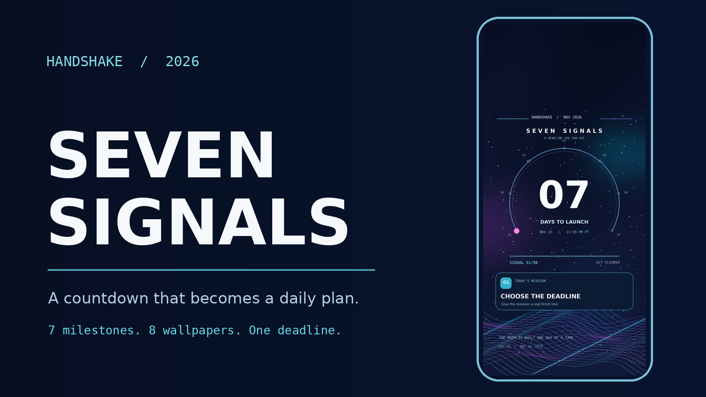

# Seven Signals — a deadline you can see

**Live page: https://redafrix.github.io/seven-signals-countdown/**

An original phone lock-screen series and companion website made for a Handshake AI Showcase mission
(submitted and published, November 2026). One deadline — 23 November 2026, 11:59 p.m. Pacific Time —
becomes seven daily checkpoints: each day gets its own wallpaper, lights one more beacon on an orbit,
and shows one small action to do that day.



## What's inside

| Path | What it is |
|---|---|
| `index.html` | responsive companion page: live countdown to the exact deadline, day-by-day action selector, wallpaper gallery |
| `wallpapers/` | eight 1290 × 2796 lock screens, 16 → 23 Nov (D7 → D0) |
| `Cover_Seven_Signals_*.png` | cover images (16:9 and 3:2) |
| `build_seven_signals.py` | generates all the artwork from scratch (Python + Pillow) |
| `PROJECT_PLAN_AND_SUBMISSION.md` | the plan, design choices and the submission text |
| `SUBMISSION_CONFIRMED.txt` | submission confirmation |

## Design notes

- The top of every wallpaper is left empty so the phone's own clock and notifications stay readable.
- One action per day, so the screen never turns into a to-do list.
- Dark cyan / indigo palette with faint contour lines: a route forward, not a wall.

## Rebuild the artwork

```bash
pip install pillow
python build_seven_signals.py
```

Made with Python/Pillow, HTML, CSS and JavaScript; ChatGPT helped with the concept and planning.
